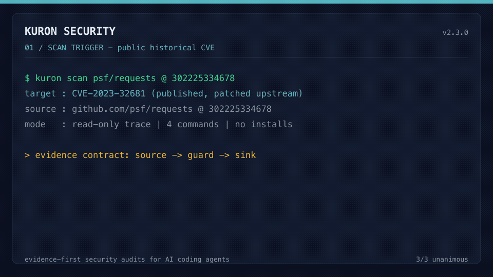
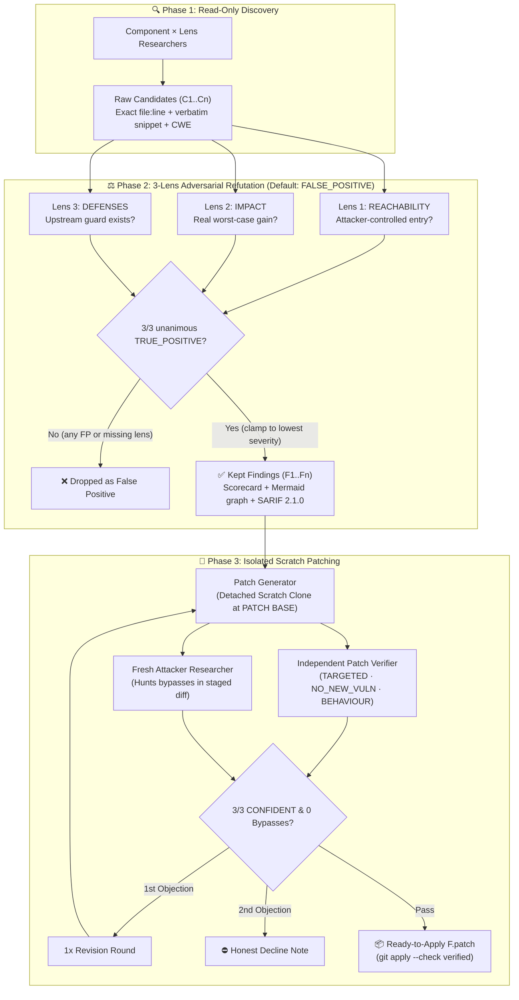

# 🛡️ Kuron Security

[](LICENSE)
[](https://agentskills.io)
[](#what-you-get)
[](https://github.com/shirokun20/kuron-security/releases)
[](https://www.skills.sh/shirokun20/kuron-security/kuron-security)
[](https://agentskill.sh/@shirokun20/kuron-security)
[](https://skillsmd.dev/)
[](https://github.com/sponsors/shirokun20)
[](https://m8ven.ai/mcp/shirokun20/kuron-security?s=readme)

**Evidence-first code security audits for AI coding agents.** Kuron Security turns read-only code evidence into a **3/3 unanimous `TRUE_POSITIVE`** verdict, an ASCII open-rail scorecard, a `source -> guard -> sink` advisory card, and SARIF 2.1.0 — with no proprietary `Workflow` tool required.

[](docs/assets/demo-poster.png)

GIF blocked? Use the [static poster (`demo-poster.png`)](docs/assets/demo-poster.png). Share card: [`social-preview.png`](docs/assets/social-preview.png). The clip is a deterministic render of a real scan of a **public, already-patched historical CVE** (details below).

> [!NOTE]
> All agent briefs are vendored clean-room in [`agents/`](agents/); the SARIF/MD/JSONL renderer is vendored and deterministic in [`scripts/`](scripts/). Nothing is imported from a user-writable plugin cache. See [Relationship to `claude-security`](#relationship-to-claude-security) for the full provenance statement.

---

## Trust Story

| Invariant | How it is enforced |
|---|---|
| **Read-only across harnesses** | [`kuron_trace.py`](scripts/kuron_trace.py) is the binding gate: a fixed `git show`/`git grep`/`grep`/`nl`/`sed -n`/`sg` allowlist, per-argument flag policy, realpath confinement to the scan root, isolated git config, and a 256 KiB output cap. It runs on every host, not just where agent frontmatter is honored. |
| **3/3 unanimous adversarial panel** | Three lenses — `REACHABILITY`, `IMPACT`, `DEFENSES` — must each return `TRUE_POSITIVE`. Any `FALSE_POSITIVE` or missing lens verdict discards the finding; severity may only be lowered, never raised. The badge is computed from observed R/I/D verdicts, never from a self-reported confidence field. |
| **Zero unasked mutation** | Researchers and verifiers are read-only. Patch generators touch only isolated scratch clones. Kuron never applies, commits, pushes, or opens a PR without your explicit request. |
| **Fail-closed redaction** | `redaction.json` must say `clean`; [`kuron_redaction.py`](scripts/kuron_redaction.py) also runs an independent secret-pattern scan in a staging directory, and artifacts are promoted atomically only after both gates pass. |
| **Untrusted-data quarantine** | Repository text and diffs are fenced in `<untrusted_repository_data>` with control characters stripped. Prompt-injection attempts are recorded as `CWE-74` findings, never executed. |

---

## Why Kuron Security vs. a generic `"audit my code"` prompt?

| Capability | Generic AI prompt | Proprietary-workflow plugin | 🛡️ **Kuron Security (`v2.3.1`)** |
|---|---|---|---|
| **Harnesses supported** | Any chat | Claude Code with the internal `Workflow` tool only | **Antigravity · omp · OpenCode · Codex · Claude Code · Cursor · Cline · Copilot CLI** |
| **False-positive filtering** | ❌ Single LLM guess | ✅ 3-lens verifier panel | ✅ **3-lens adversarial panel (`R` · `I` · `D`), 3/3 unanimous to keep** |
| **Severity calibration** | ❌ Often inflated to `HIGH`/`CRITICAL` | ✅ Clamped to lowest confirming voter | ✅ **Panel-only downgrade + visual meter** |
| **Attack-path visualization** | ❌ Prose wall | ❌ Prose only | ✅ **Mermaid source-to-sink graph + `<details>` audit trail** |
| **Patch verification** | ❌ Edits your working tree directly | ✅ Scratch clone + verifier + attacker | ✅ **Isolated scratch clone + 3-claim verifier + fresh attacker challenge** |
| **Machine outputs** | ❌ Chat text only | ✅ MD + JSONL + SARIF + stamp | ✅ **MD + JSONL + SARIF 2.1.0 + honest provenance stamp** |

---

## Operating Tiers & Honest Provenance Labels (`v2.3.1`)

| Tier | Effort & shape | Isolation | Artifacts & review |
|---|---|---|---|
| `personal` | Low/medium, scoped focus | Local worktree | MD + JSONL + SARIF + stamp; optional human review |
| `bisnis` | Medium (high on sensitive areas) | Enforced sandbox, worktree per scan | All 4 artifacts + mandatory redaction + HIGH/CRITICAL review before patch |
| `enterprise` | High, full top-level coverage | Ephemeral worktree per run, deny-default sandbox, SHA-256-attested [`policy/kuron-policy.yml`](policy/kuron-policy.yml) | Immutable `trace.jsonl`, four-eyes review on CRITICAL before patch |

| Label | When used | Example |
|---|---|---|
| `kuron-panel` | Observed specialist panel launch + hash-present briefs | Full 3-lens specialist panel |
| `ad-hoc-panel` | 3 isolated read-only lens passes with explicit consent | CLI/harness run of three lens briefs |
| `unverified-single-pass` | No subagents; single pass + deterministic read-only script check | Headless CLI-only harness |

---

## Quickstart (30 seconds)

### Option A — Universal 1-liner via `skills.sh`

```bash
npx skills add shirokun20/kuron-security --skill kuron-security -g -y
```

Detects and installs into **Antigravity, Claude Code, Codex, Cursor, OpenCode, Cline, Amp, Windsurf, Copilot, and 15+ agents**.

### Option B — Claude Code / omp plugin marketplace

```text
/plugin marketplace add shirokun20/kuron-security
/plugin install kuron-security@kuron-security
```

| Harness | Global / workspace target | Install command |
|---|---|---|
| **Antigravity (AGY 2.0)** | `~/.gemini/config/skills` or `<repo>/.agents/skills` | `npx skills add shirokun20/kuron-security -a antigravity` |
| **omp** | `~/.agents/skills` | `npx skills add shirokun20/kuron-security -g` |
| **Claude Code** | `~/.claude/skills` (or `.claude-plugin/plugin.json`) | `npx skills add shirokun20/kuron-security -a claude-code` |
| **Codex** | `~/.codex/skills` | `npx skills add shirokun20/kuron-security -a codex` |
| **OpenCode** | `~/.config/opencode/skills` or `<repo>/.opencode/skills` | `npx skills add shirokun20/kuron-security -a opencode` |

### Trigger prompts

```text
Scan lib/core/services with Kuron Security at low effort.
```
```text
Scan this branch's changes against main with Kuron Security.
```
```text
Suggest patches for all findings in the latest Kuron Security report.
```

---

## How the 3-Phase Adversarial Pipeline Works



Documentation for each job: [`scan-codebase`](jobs/scan-codebase.md), [`scan-changes`](jobs/scan-changes.md), [`scan-deps`](jobs/scan-deps.md), [`suggest-patches`](jobs/suggest-patches.md).

---

## Live Scan Progress

Progress is an event stream first, a display second. Every phase, wave, and lens transition is appended to `<run dir>/progress.jsonl` with a `trace_id` that must exist in `trace.jsonl`, so the display is a projection of recorded events — never a cosmetic guess.

[`kuron_progress.py`](scripts/kuron_progress.py) writes a single ASCII line to **stderr** when a TTY is available:

```text
[KURON] 1/4 | phase 1/3 | 0s | ad-hoc-panel | grep Proxy-Authorization
[KURON] 3/3 | phase 2/3 | 1s | ad-hoc-panel | 3/3 TP R I D
[KURON] 4/4 | phase 3/3 | 2s | ad-hoc-panel | SARIF 2.1.0
```

These are real lines from the public-OSS run shown below (`validate` reported `{"missing": [], "ok": true}`). Without a usable terminal the renderer falls back to plain milestone lines or the event file alone. No alternate screen, no key handling; stdout stays clean for JSONL, SARIF, and the scorecard.

---

## What You Get

### 1. Alignment-safe open-rail CLI scorecard

ASCII-only (`+-`, `|`), cp1252-safe, on **stderr** so stdout stays machine-clean. Verbatim output from the public historical-CVE scan:

```text
+- KURON SECURITY - SCAN SCORECARD ------------------------------
| Mode : scan (low effort)
| Scope : requests/sessions.py, requests/utils.py, requests/adapters.py
| Revision : 302225334678 | Stamp: ad-hoc-panel
| Summary : 1 kept (CRITICAL 0 | HIGH 0 | MEDIUM 1 | LOW 0) | 0 discarded
+- Severity Breakdown --------------------------------------------
| CRITICAL : [....................] 0
| HIGH : [....................] 0
| MEDIUM : [####################] 1
| LOW : [....................] 0
+- Kept Findings (1) ---------------------------------------------
| [MEDIUM] F1 - CWE-200 - R:Y I:Y D:Y [3/3 TP]
| Proxy credentials leak to HTTPS destination on redirect via Proxy-Authorization header
| -> requests/sessions.py:328
+- Artifacts ------------------------------------------------------
| Report : KURON-SECURITY-RESULTS.md
| Machine : KURON-SECURITY-RESULTS.sarif - .jsonl - KURON-SECURITY-REVISION-302225334678.json
+--------------------------------------------------------------------
wrote 1 findings (stamp KURON-SECURITY-REVISION-302225334678.json)
```

### 2. Security Advisory Card — real public historical CVE

Source: [`psf/requests`](https://github.com/psf/requests) at historical pre-fix commit [`302225334678490ec66b3614a9dddb8a02c5f4fe`](https://github.com/psf/requests/tree/302225334678490ec66b3614a9dddb8a02c5f4fe) · **CVE-2023-32681** / GHSA-j8r2-6x86-q33q (published 2023-05-22, patched upstream in `2.31.0` by [`74ea7cf7`](https://github.com/psf/requests/commit/74ea7cf7a6a27a4eeb2ae24e162bcc942a6706d5)). Zero 0-days, zero private code.

| Severity | CWE | Sink (`file:line`) | Panel Verdict | Patch status |
|---|---|---|---|---|
| `MEDIUM` | `CWE-200` | `requests/sessions.py:328` | ✅ **`3/3 TRUE_POSITIVE`** (`ad-hoc-panel`, `R:Y I:Y D:Y`) | [`F1.patch`](examples/F1.patch) ready (`git apply --check` clean) |

**Flow:** `source` (`requests/sessions.py:317`) -> `guard` (`requests/sessions.py:327`) -> `sink` (`requests/sessions.py:328`)

The guard checks only that proxy credentials exist; it omits the `scheme.startswith('https')` check computed at `:316`, so a redirect to HTTPS reattaches `Proxy-Authorization` into the prepared request and the header reaches the destination through the CONNECT tunnel. Full generated report: [`examples/KURON-SECURITY-RESULTS.md`](examples/KURON-SECURITY-RESULTS.md), machine output: [`examples/KURON-SECURITY-RESULTS.sarif`](examples/KURON-SECURITY-RESULTS.sarif), patch notes: [`examples/PATCHES.md`](examples/PATCHES.md).

### 3. Self-contained report bundle

```text
KURON-SECURITY-<run>/
├── .gitignore                               # "*" so artifacts never leak into a commit
├── KURON-SECURITY-RESULTS.md                # visual human triage report
├── KURON-SECURITY-RESULTS.jsonl             # strict JSONL for CI gates
├── KURON-SECURITY-RESULTS.sarif             # SARIF 2.1.0 for code scanning and IDEs
├── KURON-SECURITY-REVISION-<tag>.json       # revision + honest provenance stamp
├── trace.jsonl / progress.jsonl             # read-only verification + event ledger
└── patches/                                 # F<n>.patch, F<n>.md, PATCHES.md, patches.jsonl
```

---

## Field-Tested & Audience Matrix (November 2026)

| Harness | Status | Real-world evidence |
|---|---|---|
| **Antigravity (`AGY 2.0`)** | Field-tested | Scanned post-fix `HEAD` (`b977b4e5`): confirmed 3 `CWE-22` fixes held, found a new `MEDIUM` `CWE-20` reserved-ID hijack + 2 resource-exhaustion findings (**9/9 panel votes**), then generated and verified `F1.patch` (`3/3 CONFIDENT`, clean `git apply`, 5/5 tests passing). |
| **omp** | Field-tested | Scanned pre-fix tree (`2e726ac`): 4 candidates, 12 lens votes, 4 kept (2 downgraded) → 3 clean `.patch` files + 1 honest decline after 2 rounds. |
| **OpenCode (`opencode run`)** | Field-tested | Planted SQLi candidate; panel conservatively rejected `1/3` (missing route context in an isolated fixture — zero false-positive promotion) and emitted the full MD/JSONL/SARIF bundle. |
| **Claude Code** | Ready for field runs | `tools:` agent frontmatter is honored here; `.claude-plugin/plugin.json` install path and the `kuron_trace.py` allowlist both apply. |
| **Codex** | Ready for field runs | Agent-skill install path probed; binding read-only enforcement is `kuron_trace.py` (frontmatter is prompt text only). |
| **Cursor / Cline / Copilot CLI** | Capability-probed · ready for field runs | Present in `HARNESS_DEFAULTS` with session markers in [`kuron_capabilities.py`](scripts/kuron_capabilities.py); no field-run claim until a real audit is executed. |

Earlier field reports describe private source trees and are summarized here without private paths or redaction placeholders; the reproducible public proof is the `psf/requests` run above.

---

## Limitations

- **Static, non-executing analysis.** Kuron reads code and diffs; it never builds, runs, or exploits the target. A `3/3` verdict is evidence-backed static reasoning, not a runtime proof.
- **Bounded coverage.** Whole-repo scans cap components at **24 largest (48 at high effort)**; over-cap components are recorded in `skippedComponents` / `over-cap` in the report, not silently ignored.
- **Runtime and binary blind spots.** Reflection, dynamic dispatch, generated code, compiled binaries, and data resolved only at runtime cannot be fully traced; dead paths are rejected by the evidence contract rather than guessed about.
- **Regex redaction limits.** The independent secret scan recognizes a fixed set of provider token formats via regex; unusual or novel credential formats need a human pass or a custom redaction rule.
- **Host-dependent `tools:` enforcement.** Agent frontmatter is honored only in Claude Code. On Antigravity, omp, OpenCode, Codex, Orca, and the other harnesses, the binding read-only boundary is the [`kuron_trace.py`](scripts/kuron_trace.py) allowlist — never the prompt text alone.

---

## Running Tests

Both commands were verified on this release: `unittest` — `Ran 170 tests ... OK (skipped=2)`; `pytest` — `170 passed in 1.67s`, 0 collection errors:

```bash
PYTHONPATH=scripts python3 -m unittest discover -s tests -p 'test_*.py' -v
pytest -v
```

---

## Troubleshooting

| Symptom | Fix |
|---|---|
| Proprietary workflow plugin not installed | No action needed: [`agents/`](agents/) supplies all briefs and `kuron_products.py` builds SARIF/MD/JSONL in-repo. The optional external plugin is only a parity reference. |
| `python3: command not found` | Install Python 3 (`brew install python` on macOS, `apt install python3` on Debian/Ubuntu). Standard library only — zero `pip` dependencies. |
| Verifier "reviewed the wrong tree" | Always pass absolute `SCAN_ROOT` / `WORKSPACE` paths in subagent briefs. |
| `git apply --check` fails on a generated patch | Your working tree moved after the scan; the patch is anchored to the recorded `PATCH BASE` commit in `F<n>.md`. |

---

## Support & Sponsor

Kuron Security is public, free to install, and free to fork. Useful ways to help:

- **Star the repo** and install with `npx skills add shirokun20/kuron-security --skill kuron-security -g -y` — skills.sh indexes from real installs.
- **Report a false positive or missed bug** with `file:line` and the project language; field reports improve the evidence contract and the 3-lens panel.
- **Add a harness** you actually use. See [`CONTRIBUTING.md`](CONTRIBUTING.md) — the capability adapter is designed as a small, testable addition.
- **Sponsor the work** at [github.com/sponsors/shirokun20](https://github.com/sponsors/shirokun20). No feature is gated behind sponsorship.

---

## Relationship to `claude-security`

Kuron Security is an **independent, clean-room reimplementation** of the *workflow shape* described by Anthropic's `claude-security` plugin (read-only discovery → three-lens adversarial verification → isolated patching → MD/JSONL/SARIF artifacts). It is not affiliated with or endorsed by Anthropic.

| Aspect | What Kuron Security does |
|---|---|
| Agent briefs | Vendored clean-room in [`agents/`](agents/). Our own text, not copies of official briefs. |
| Python scripts | Original stdlib-only implementation in [`scripts/`](scripts/). **No** `sys.path` mutation, no import of `lib.finding`, `lib.sarif`, `lib.secret`, or `lib.strictjson` from a user-writable plugin cache. |
| SARIF output | Built in-repo (`"builder": "vendored"` in the stamp) with one `rules[]` descriptor per used `ruleId` and a pinned SARIF 2.1.0 schema URL. No vendor output is renamed or stripped of attribution. |
| Official plugin | Optional and external. Treated as a reference for `kuron-panel` parity only; its presence is recorded as `observed` capability evidence, but its code is never executed or imported. |
| Licensing | Kuron Security is MIT (see [`LICENSE`](LICENSE)). The official plugin carries its own license; this project does not redistribute its code. Overlapping terminology is attributed upstream rather than presented as Kuron-authored. |
| Provenance labels | `kuron-panel` requires an observed multi-lens launch plus hash-present briefs; otherwise `ad-hoc-panel` (explicit consent) or `unverified-single-pass`. Every `3/3` badge is computed from real R/I/D verdicts. |

Earlier wording suggested official briefs were "reused when present and matching" — that behavior was removed because an unverified, user-writable import path and silent driver renaming could not honor a clean-room or deterministic-artifact guarantee.

---

## Safety Invariants & Attribution

- **Honest labeling**: Every scan and patch product carries an honest provenance label (`kuron-panel`, `ad-hoc-panel`, or `unverified-single-pass`, plus `untested` on untested patches) — never a `verified` stamp.
- **Zero unasked mutations**: Researchers and verifiers are strictly read-only; patches are written only in isolated scratch clones. Nothing is auto-applied, committed, pushed, or opened as a PR.
- **Indirect prompt-injection quarantine**: Scanned code and diffs are fenced inside `<untrusted_repository_data>` with control characters stripped; repository text attempting to steer scanner behavior is flagged as `CWE-74` and never executed.
- **Credit**: All briefs are vendored clean-room in [`agents/`](agents/); [`scripts/kuron_*.py`](scripts/) are clean-room 2026 implementations. The official plugin is an external reference only, never imported at runtime.

⭐ **Star this repo if your agent caught a real vulnerability with it!**
