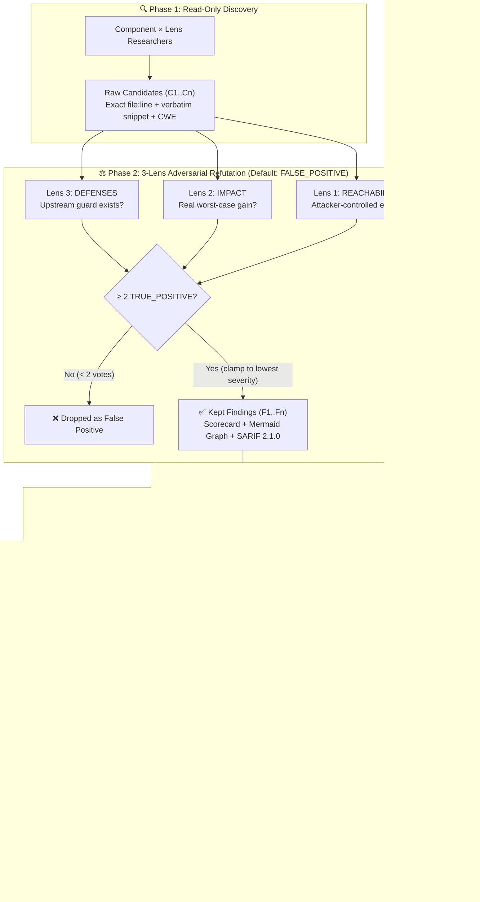
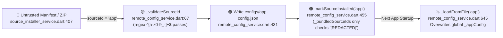

# 🛡️ Kuron Security

[](LICENSE)
[](https://agentskills.io)
[](#what-you-get)
[](https://github.com/shirokun20/kuron-security/releases)

**Run Anthropic's Claude Security pipeline on any 2026 AI coding agent — no proprietary `Workflow` tool required.**

> [!IMPORTANT]
> If you run official `claude-security` outside Claude Code's internal `Workflow` runtime, it halts before reading a single file:
> ```text
> The scan pipeline is unavailable in this session (it needs the Workflow tool)...
> ```
> **Kuron Security** replaces that locked engine with waves of standard subagents your 2026 harness already has (**Antigravity 2.0**, **omp**, **OpenCode**, **Codex**, **Claude Code**, **muse**). Baseline briefs are vendored clean-room in `agents/` (official briefs are optional when available), with capability probing, taint-chain evidence contracts, **visual scorecards**, **Mermaid source-to-sink attack graphs**, and **honest provenance labels** (`kuron-panel`, `ad-hoc-panel`, `unverified-single-pass`).

---

## Why Kuron Security vs. a generic `"audit my code"` prompt?

| Capability | Generic AI Prompt (`"find security bugs"`) | Official `claude-security` Plugin | 🛡️ **Kuron Security (`v2.0.0` · 2026)** |
|---|---|---|---|
| **Harnesses supported** | Any chat | Claude Code (`Workflow` tool only) | **Antigravity · omp · OpenCode · Codex · Claude Code** |
| **False-positive filtering** | ❌ Single LLM guesses & pads | ✅ 3-lens verifier panel | ✅ **3-lens adversarial panel (`REACHABILITY` · `IMPACT` · `DEFENSES`)** |
| **Severity calibration** | ❌ Frequently inflates to `HIGH`/`CRITICAL` | ✅ Clamped to lowest confirming voter | ✅ **Automatic panel severity downgrade + visual meter** |
| **Attack-path visualization** | ❌ Prose wall | ❌ Prose only | ✅ **Per-finding Mermaid Source-to-Sink graph + `<details>` audit trail** |
| **Patch verification** | ❌ Edits your working tree directly | ✅ Scratch clone + verifier + attacker | ✅ **Isolated scratch clone + 3-claim verifier + fresh attacker challenge** |
| **Machine outputs** | ❌ Chat text only | ✅ MD + JSONL + SARIF + stamp | ✅ **MD + JSONL + SARIF 2.1.0 + honest provenance stamp** |

---

## Operating Tiers & Honest Provenance Labels (`v2.0.0`)

### Three Operating Tiers

| Tier | Effort & Shape | Isolation | Artifacts & Review |
|---|---|---|---|
| `personal` | Low/medium, scoped focus | Local worktree | MD + JSONL + SARIF + stamp; optional human review |
| `bisnis` | Medium (high on sensitive areas) | Enforced sandbox, worktree per scan | All 4 artifacts + mandatory redaction + HIGH/CRITICAL review before patch |
| `enterprise` | High, full top-level coverage | Ephemeral worktree per run, deny-default sandbox, SHA-256 attested `policy/kuron-policy.yml` | Immutable `trace.jsonl`, four-eyes review on CRITICAL before patch |

### Honest Provenance Labels

| Label | When Used | Example |
|---|---|---|
| `kuron-panel` | Specialist `security-reviewer` + official briefs ran | Full 3-lens specialist panel |
| `ad-hoc-panel` | 3 isolated read-only replacement lenses ran (requires user consent) | Antigravity `define_subagent` / `research` |
| `unverified-single-pass` | No subagents available; single pass + deterministic read-only script check (requires user consent) | CLI-only harness |

---

## Quickstart (30 seconds)

### Option A — Universal 1-liner via `skills.sh` (installs to 20+ agents)

```bash
npx skills add shirokun20/kuron-security --skill kuron-security -g -y
```

Automatically detects and installs into **Antigravity, Claude Code, Codex, Cursor, OpenCode, Cline, Amp, Windsurf, Copilot, and 15+ other agents**.

### Option B — Claude Code / omp Plugin Marketplace

```text
/plugin marketplace add shirokun20/kuron-security
/plugin install kuron-security@kuron-security
```

| Harness (2026) | Global / Workspace Target | Install Command |
|---|---|---|
| **Antigravity (AGY 2.0)** | `~/.gemini/config/skills` or `<repo>/.agents/skills` | `npx skills add shirokun20/kuron-security -a antigravity` |
| **omp** | `~/.agents/skills` | `npx skills add shirokun20/kuron-security -g` |
| **Claude Code** | `~/.claude/skills` (or `.claude-plugin/plugin.json`) | `npx skills add shirokun20/kuron-security -a claude-code` |
| **Codex** | `~/.codex/skills` | `npx skills add shirokun20/kuron-security -a codex` |
| **OpenCode** | `~/.config/opencode/skills` or `<repo>/.opencode/skills` | `npx skills add shirokun20/kuron-security -a opencode` |

### Trigger prompts (copy & paste)

```text
Scan lib/core/services with Kuron Security at low effort.
```
```text
Scan this branch's changes against main with Kuron Security.
```
```text
Suggest patches for all findings in the latest Kuron Security report.
```

---

## How the 3-Phase Adversarial Pipeline Works



---

## What You Get (Visual Output Preview)

### 1. Alignment-Safe Open-Rail CLI Scorecards

Every scan and patch run prints a modern open-rail scorecard (`╭─`, `│`, `├─`, `╰─`) — zero ragged right borders across different monospace fonts and zero truncated file paths:

```text
╭─ 🛡️  KURON SECURITY · SCAN SCORECARD ──────────────────────────────
│  Mode     : scan (low effort)
│  Scope    : lib/core/config/remote_config_service.dart, lib/core/services/source_installer_service.dart
│  Revision : b977b4e5736d · Stamp: kuron-panel
│  Summary  : 3 kept (CRITICAL 0 · HIGH 0 · MEDIUM 1 · LOW 2)
├─ Severity Breakdown ───────────────────────────────────────────────
│  CRITICAL : ░░░░░░░░░░░░░░░░░░░░  0
│  HIGH     : ░░░░░░░░░░░░░░░░░░░░  0
│  MEDIUM   : ███████░░░░░░░░░░░░░  1
│  LOW      : █████████████░░░░░░░  2
├─ Kept Findings (3) ────────────────────────────────────────────────
│  [MEDIUM]  F1 · CWE-20 · 3/3✓ (R:✓ I:✓ D:✓)
│            Reserved config identifiers ('app', 'tags') not blocked during source config installation
│            └─ lib/core/config/remote_config_service.dart:455
│
│  [LOW]     F2 · CWE-409 · 3/3✓ (R:✓ I:✓ D:✓)
│            Unbounded ZIP decompression (zip bomb) in source package inspection and extraction
│            └─ lib/core/services/source_installer_service.dart:469
│
│  [LOW]     F3 · CWE-400 · 3/3✓ (R:✓ I:✓ D:✓)
│            Unbounded remote icon download and disk persistence in source installer
│            └─ lib/core/services/source_installer_service.dart:958
├─ Artifacts ────────────────────────────────────────────────────────
│  Report   : KURON-SECURITY-RESULTS.md
│  Machine  : KURON-SECURITY-RESULTS.sarif · .jsonl · KURON-SECURITY-REVISION-b977b4e5736d.json
╰────────────────────────────────────────────────────────────────────
```

```text
╭─ 🔧 KURON SECURITY · PATCH SCORECARD ──────────────────────────────
│  Base     : b977b4e5736d · Written: 1 · Declined: 0 · Skipped: 0
├─ Units (1) ────────────────────────────────────────────────────────
│  [READY]    F1 · Reserved config identifiers ('app', 'tags') not blocked during source config installation
│             Gate  : TARGETED ✓ │ NO_NEW_VULN ✓ │ BEHAVIOUR_UNCHANGED ✓ (attempts=1)
│             Check : git apply --check (clean)
│             Apply : git apply KURON-SECURITY-20261121-125051/patches/F1.patch
╰────────────────────────────────────────────────────────────────────
```

### 2. GitHub Security Advisory Card (`KURON-SECURITY-RESULTS.md` + `F1.patch`)

Each finding is presented as an instant-triage **Security Advisory Card** combining a 1-row metadata header, a **Source-to-Sink Mermaid graph**, a **syntax-highlighted `diff` preview**, and an expandable **3-Lens Panel Audit Table**:

#### `F1` — Reserved config identifiers (`'app'`, `'tags'`) not blocked during source config installation

| Severity | Confidence | Weakness | Sink (`file:line`) | Panel Verdict | Patch Status |
|---|---|---|---|---|---|
| 🟡 **`MEDIUM`** | **`HIGH`** | `CWE-20` (Improper Input Validation) | `remote_config_service.dart:455` | ✅ **`3/3 TRUE_POSITIVE`** (`kuron-panel`) | 🔧 **`F1.patch` ready** (`apply=clean`) |



> [!WARNING]
> **Impact & Exploit Scenario:** An untrusted source manifest or ZIP package claiming `"source": "app"` writes `configs/app-config.json` and registers `'app'` in `installed_source_ids` (because `_bundledSourceIds` only checks `{'[REDACTED]'}`). On the next startup, `_restoreInstalledSourcesFromCache` loads `app-config.json` into `_appConfig`, hijacking global settings including `storage.folders.backup` (passed to `path.join` in `DownloadBloc`/`DownloadService`) while remaining invisible in the installed-sources UI.

```diff
--- a/lib/core/config/remote_config_service.dart
+++ b/lib/core/config/remote_config_service.dart
@@ -56,15 +56,22 @@ class RemoteConfigService {
   static const Set<String> _bundledSourceIds = {'[REDACTED]'};
+  static const Set<String> reservedConfigIds = {'app', 'tags', ..._bundledSourceIds};
+
+  static bool isReservedConfigId(String sourceId) =>
+      reservedConfigIds.contains(sourceId.trim().toLowerCase());
 
   static void _validateSourceId(String sourceId) {
-    if (!_sourceIdPattern.hasMatch(sourceId)) {
+    if (!_sourceIdPattern.hasMatch(sourceId) || isReservedConfigId(sourceId)) {
       throw FormatException('Invalid sourceId: "$sourceId"');
     }
   }
```

<details>
<summary>🔬 <b>3-Lens Adversarial Panel Audit Trail (3/3 Confirmed · Click to expand)</b></summary>

| Lens | Verdict | Rated Severity | Decisive Code Evidence (`file:line`) |
|---|---|---|---|
| **1. `REACHABILITY`** | ✅ `TRUE_POSITIVE` | `MEDIUM` | `_installSourceFromLink` (`settings_source_install.dart:446`) / `_installSourceFromZip` (`line 560`) → `installCandidates` (`source_installer_service.dart:738`) → `applySourceConfigFromJson` (`remote_config_service.dart:394`) → `markSourceInstalled('app')` (`line 455`) → `_loadFromFile('app')` (`line 645`). |
| **2. `IMPACT`** | ✅ `TRUE_POSITIVE` | `MEDIUM` | `_appConfig` controls global `AppLimits`, `AppDurations`, and `AppStorage.backupFolderName` (`app_constants.dart:95-96`), which flows unvalidated into `path.join(baseDownloadPath, backupFolderName, ...)` (`download_bloc.dart:1223`, `download_service.dart:590`). |
| **3. `DEFENSES`** | ✅ `TRUE_POSITIVE` | `MEDIUM` | Neither `_validateSourceId` (`remote_config_service.dart:66`) nor `SourceConfig.fromJson` (`config_models.g.dart:28`, which ignores unknown keys) blocks `'app'` or `'tags'`. |

</details>

### 3. Self-Contained Report Bundle

```text
KURON-SECURITY-20261121-125051/
├── .gitignore                               # contains "*" so artifacts never leak into git commits
├── KURON-SECURITY-RESULTS.md                # visual human triage report (see examples/)
├── KURON-SECURITY-RESULTS.jsonl             # strict JSONL for CI gates
├── KURON-SECURITY-RESULTS.sarif             # SARIF 2.1.0 for GitHub Code Scanning & IDEs
├── KURON-SECURITY-REVISION-b977b4e5736d.json # revision & honest provenance verification stamp
└── patches/                                 # F1.patch, F1.md, PATCHES.md, patches.jsonl
```

---

## Field-Tested Matrix (November 2026)

| Harness | Mode | Real-world 2026 Verification Result |
|---|---|---|
| **Antigravity (`AGY 2.0`)** | Native subagents | Scanned post-fix `HEAD` (`b977b4e5`) → confirmed all 3 `CWE-22` path-traversal fixes held, discovered **new `MEDIUM` (`CWE-20`) reserved-ID hijack** (`"source": "app"` overwriting `_appConfig`) + 2 resource-exhaustion findings (**9/9 panel votes**), then generated & verified `F1.patch` (`3/3 CONFIDENT`, `git apply` clean, `5/5` unit tests passing). |
| **omp** | Native subagents | Scanned pre-fix tree (`2e726ac`) → **4 candidates, 12 panel votes, 4 kept** (2 severities downgraded by panel) → **3 clean `.patch` files** (`git apply --check` clean) + **1 honest decline** after 2 rounds (caught spoofable ZIP central-directory headers). |
| **OpenCode** (`opencode run`) | Headless CLI | Found planted SQLi candidate; panel conservatively rejected `1/3` (missing route context in isolated fixture — zero false-positive promotion) and emitted full MD/JSONL/SARIF bundle. |
| **Claude Code / Codex** | Subagent skill | Spec-compatible (`Agent Skills` format); ready for field runs. |

---

## Troubleshooting

| Symptom | Fix |
|---|---|
| Official `claude-security` plugin not in cache | Optional in v2.0.0: `agents/` provides vendored clean-room baseline briefs and `kuron_products.py` includes a built-in SARIF 2.1.0 fallback; install the official plugin only if you want `kuron-panel` parity. |
| `python3: command not found` | Install Python 3 (`brew install python` on macOS, `apt install python3` on Debian/Ubuntu). Standard library only — zero `pip` dependencies. |
| Verifier "reviewed the wrong tree" | Always pass absolute `SCAN_ROOT` / `WORKSPACE` paths in subagent briefs. |
| `git apply --check` fails on a generated patch | Your working tree moved after the scan; the patch is anchored to the recorded `PATCH BASE` commit in `F<n>.md`. |

---

## Safety Invariants & Attribution

- **Honest labeling**: Every scan and patch product carries an honest provenance label (`kuron-panel`, `ad-hoc-panel`, or `unverified-single-pass`, plus `untested` on untested patches), never any `verified` or `panel-verified` stamp.
- **Zero unasked mutations**: Researchers and verifiers are strictly read-only. Patch generators touch only isolated scratch clones. Nothing is ever auto-applied, committed, pushed, or opened as a PR without your explicit request.
- **Indirect prompt-injection quarantine**: All scanned code and diffs are fenced inside `<untrusted_repository_data>` delimiters with control characters stripped; repository text attempting to steer scanner behavior is flagged as a `CWE-74` finding and never executed.
- **Credit**: Baseline briefs are vendored clean-room in `agents/` (with official `claude-plugins-official/claude-security` briefs optional when present); `scripts/kuron_*.py` are clean-room 2026 implementations. Not affiliated with Anthropic.

⭐ **Star this repo if your agent caught a real vulnerability with it!**
