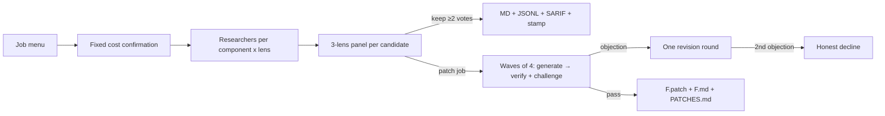

# 🛡️ Kuron Security

[](LICENSE)
[](https://agentskills.io)
[](https://github.com/shirokun20/kuron-security/releases)
[](#install)

**Claude Security scans — on any AI agent.** Codebase scan, scan changes, and
suggest patches, with a parallel researcher + 3-lens verifier panel, for
sessions that don't have Claude Code's `Workflow` tool. Reports keep the
official shape (Markdown, JSONL, SARIF, revision stamp) with honestly-labeled
`kuron-panel` verification.

> Credit: adapted from Anthropic's **Claude Security** plugin
> (`claude-plugins-official/claude-security`). Prompts, severity scale and
> report/patch shapes are used read-only from the official plugin;
> `scripts/kuron_*.py` are clean-room implementations. This project is not
> affiliated with Anthropic.

- [Install](#install) · [What you get](#what-you-get) · [How it works](#how-it-works) · [Harness notes](#harness-notes) · [Troubleshooting](#troubleshooting) · [Honest limits](#honest-limits) · [Contribute](#contribute)

## Install

```bash
git clone https://github.com/shirokun20/kuron-security.git
cd kuron-security
./install.sh              # symlinks into every harness it finds
./install.sh --check      # verify: skill file, python3, git
```

Per-harness, pick what you need:

```bash
./install.sh --harness claude-code   # ~/.claude/skills/kuron-security
./install.sh --harness codex         # ~/.codex/skills/kuron-security
./install.sh --harness omp           # ~/.agents/skills/kuron-security
./install.sh --harness opencode      # project .opencode/skills (run inside your repo)
./install.sh --harness antigravity   # project .agents/skills (run inside your repo)
./install.sh --local                 # project-local install for the current repo
./install.sh --uninstall             # remove all links this script made
./install.sh --list                  # show what's installed where
```

No `pip` dependencies — both scripts are Python-3 stdlib only (and the
official plugin already requires `python3`, so nothing new is asked of the
machine). Windows: run from Git Bash (ships with Git, which the patch job
requires anyway).

## What you get

```
KURON-SECURITY-20261121-115809/
├── KURON-SECURITY-RESULTS.md      # human report (see examples/)
├── KURON-SECURITY-RESULTS.jsonl   # one finding per line (CI gates)
├── KURON-SECURITY-RESULTS.sarif   # dashboards & IDE viewers
├── KURON-SECURITY-REVISION-*.json # stamp: kuron-panel, never "verified"
└── patches/
    ├── F1.patch  F1.md  …        # panel-verified patches, apply when YOU choose
    └── PATCHES.md                 # index + trust labels
```

Real output from the field test ([examples/](examples/)):

```markdown
### F1 — Path traversal file write via unsanitized remote sourceId (LOW, high)

**Impact.** Attacker-controlled JSON persisted outside `configs/` …
**Where.** `remote_config_service.dart:407` — CWE-22
**Verification.** 3/3 lens verifiers confirmed (severity lowered HIGH→LOW).
```

## How it works



Ask your agent: *"scan this repo with kuron-security"*, *"review my branch
changes"*, or *"suggest patches for F1, F3"*. One scoped question, one fixed
confirmation, then it works unattended in waves.

## Harness notes

| Harness | Skills dir | Notes |
|---|---|---|
| omp / generic agents | `~/.agents/skills/kuron-security` | built & tested here |
| Claude Code | `~/.claude/skills/kuron-security` | or install as plugin via `.claude-plugin/plugin.json` |
| Codex | `~/.codex/skills/kuron-security` | spec-compatible |
| OpenCode | project `.opencode/skills/` or `~/.config/opencode/skills/` | run `./install.sh --local` inside your repo |
| Antigravity | project `.agents/skills/` | run `./install.sh --local` inside your repo |

## Troubleshooting

| Symptom | Fix |
|---|---|
| `python3: command not found` | Install Python 3 (macOS: `brew install python`; Debian: `apt install python3`) |
| `omp skill publish` → frontmatter error | Fixed in v1.0.0 (quoted description); pull latest |
| Verifier "reviewed the wrong tree" | Known subagent limitation; the skill anchors briefs to absolute `WORKSPACE` paths — paste the diff, never rely on its shell |
| Patch job refuses `repo-root is not a repository top level` | Use the real path (`realpath`); symlinked `/tmp` on macOS is resolved since v1.0.0 |
| `git apply` check fails on a patch | Tree moved under the patch; the patch still stands (built at recorded PATCH BASE) |

## Honest limits

- Verification is `kuron-panel`, never the official `verified` stamp (that
  calibration belongs to Anthropic's Workflow pipeline — forging it would be
  fabrication).
- `high` effort at full-repo scale and no-finding patch runs are implemented
  but await field tests with real findings. The engine refuses to invent
  findings to test itself.
- Nothing auto-applies, commits, pushes, or opens PRs. Ever.

## Contribute

Field reports welcome: new harness paths for `install.sh`, verifier edge
cases, SARIF consumer fixes. Open an issue with your harness + transcript
snippet (templates provided); PRs must keep the safety invariants untouched
and field-test on a real scope.

⭐ Star it if your agent found a real bug with it — that signal matters more
than any badge.
