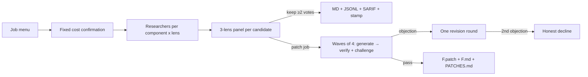

# 🛡️ Kuron Security

[](LICENSE)
[](https://agentskills.io)
[](https://github.com/shirokun20/kuron-security/releases)

Claude Security jobs (codebase scan, scan changes, suggest patches) for AI
agents **without** Claude Code's `Workflow` tool. Same menu, same safety
rules, same report shape — engine replaced with subagents your harness
already has. Stamped `kuron-panel`, never `verified`.

> Adapted from Anthropic's **Claude Security** plugin; prompts and shapes
> used read-only, `scripts/kuron_*.py` are clean-room. Not affiliated.

## Install

```bash
git clone https://github.com/shirokun20/kuron-security.git
cd kuron-security && ./install.sh   # symlinks into every harness found
```

| Harness | Target | Command |
|---|---|---|
| omp / generic | `~/.agents/skills` | `./install.sh` (auto) |
| Claude Code | `~/.claude/skills` | `./install.sh --harness claude-code` (or install as plugin via `.claude-plugin/plugin.json`) |
| Codex | `~/.codex/skills` | `./install.sh --harness codex` |
| OpenCode | project `.opencode/skills` | `./install.sh --local` inside your repo |
| Antigravity | project `.agents/skills` | `./install.sh --local` inside your repo |

`./install.sh --check` verifies skill + python3 + git. No `pip` deps
(stdlib only). Windows: use Git Bash.

## Field-tested on

| Harness | Mode | Result |
|---|---|---|
| omp | native | 4 real findings → 12 panel votes → 4 kept → 3 patches (`git apply --check` clean) + 1 honest decline |
| OpenCode (`opencode run`) | headless | Planted SQLi: candidate found, panel rejected 1/3 (no route context — conservative by design), full MD/JSONL/SARIF produced |
| Antigravity (`agy -p`) | headless | Skill discovered, confirmation quoted verbatim; full scan not yet run |
| Claude Code / Codex | — | Spec-compatible, awaiting a field run |

## What you get

```
KURON-SECURITY-<ts>/
├── KURON-SECURITY-RESULTS.md       # human report (see examples/)
├── KURON-SECURITY-RESULTS.jsonl    # CI gates
├── KURON-SECURITY-RESULTS.sarif    # dashboards & IDEs
├── KURON-SECURITY-REVISION-*.json  # stamp: kuron-panel
└── patches/                        # F<n>.patch + F<n>.md + PATCHES.md
```

```markdown
### F1 — Path traversal file write via unsanitized sourceId (LOW, high)

**Impact.** Attacker-controlled JSON persisted outside `configs/` …
**Where.** `remote_config_service.dart:407` — CWE-22
**Verification.** 3/3 lens verifiers confirmed (HIGH→LOW by the panel).
```

## How it works



## Troubleshooting

| Symptom | Fix |
|---|---|
| `python3: command not found` | Install Python 3 (macOS: `brew install python`; Debian: `apt install python3`) |
| `omp skill publish` frontmatter error | Fixed in v1.0.0 (quoted description); pull latest |
| Verifier "reviewed the wrong tree" | Anchor briefs to absolute `WORKSPACE` paths; never rely on the subagent's shell |
| `git apply` check fails on a patch | Tree moved under the patch; it still stands (built at recorded PATCH BASE) |

## Honest limits

- `kuron-panel`, never the official `verified` stamp (forging it is fabrication).
- `high` at full-repo scale and no-finding patch runs await field tests.
- Nothing auto-applies, commits, pushes, or opens PRs. Ever.

Contribute: issues have templates (bug / panel dispute / harness). PRs keep
the safety invariants untouched and field-test on a real scope.

⭐ Star it if your agent found a real bug with it.
