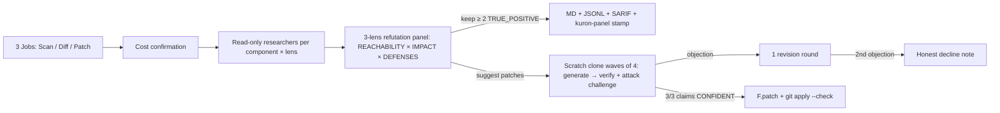

# 🛡️ Kuron Security

[](LICENSE)
[](https://agentskills.io)
[](https://github.com/shirokun20/kuron-security/releases)

**Run Anthropic's Claude Security pipeline on any AI coding agent — no proprietary `Workflow` tool required.**

If you try running official `claude-security` outside Claude Code's internal workflow runtime, it stops before reading a single file:

```text
The scan pipeline is unavailable in this session (it needs the Workflow tool)...
```

**Kuron Security** replaces that locked workflow engine with waves of standard subagents your harness already supports (**Antigravity**, **omp**, **OpenCode**, **Codex**, **Claude Code**). You get the exact same three jobs, official researcher/verifier prompts, CWE mapping, and SARIF/JSONL products — honestly stamped `kuron-panel`.

---

## Why use this instead of `"audit my code for bugs"`?

Single-prompt security audits hallucinate theoretical risks and inflate severities. Kuron Security enforces an adversarial multi-agent pipeline:

- **Source-to-sink researchers** trace untrusted input across file boundaries to a concrete `file:line` sink and verbatim code snippet.
- **3-lens refutation panel per candidate** — three independent verifiers (**`REACHABILITY`**, **`IMPACT`**, **`DEFENSES`**) start from `FALSE_POSITIVE` and try to **disprove** the finding. A candidate survives only with **≥ 2 `TRUE_POSITIVE` votes**, and the panel automatically downgrades inflated severity to the lowest confirming vote.
- **Adversarial patch waves** — for every finding you choose to fix, a generator stages a patch in an isolated scratch clone while an independent verifier + a fresh attacker challenge the diff before emitting a ready-to-apply `.patch`.
- **Zero unasked mutations** — researchers and verifiers are strictly read-only. Nothing is ever auto-applied, committed, pushed, or opened as a PR.

---

## Quickstart (30 seconds)

```bash
git clone https://github.com/shirokun20/kuron-security.git
cd kuron-security
./install.sh          # auto-links into every installed harness
./install.sh --check  # verifies SKILL.md, python3 (stdlib only), git, and scripts
```

| Harness | Global / Project Path | Install Command |
|---|---|---|
| **Antigravity** | `~/.gemini/config/skills` or `<repo>/.agents/skills` | `./install.sh` or `./install.sh --local` |
| **omp** | `~/.agents/skills` | `./install.sh` |
| **Claude Code** | `~/.claude/skills` (or `.claude-plugin/plugin.json`) | `./install.sh --harness claude-code` |
| **Codex** | `~/.codex/skills` | `./install.sh --harness codex` |
| **OpenCode** | `~/.config/opencode/skills` or `<repo>/.opencode/skills` | `./install.sh` or `./install.sh --local` |

### Try it in your agent

Once installed, just ask your agent in plain English:

```text
Scan lib/core/services with Kuron Security at low effort.
```
```text
Scan this branch's changes against main with Kuron Security.
```
```text
Suggest patches for all findings in the latest Kuron Security report.
```

---

## Field-tested results

Tested on real production repositories and planted vulnerabilities across multiple agent harnesses:

| Harness | Mode | Real-world result |
|---|---|---|
| **omp** | Native subagents | Scanned pre-fix tree → **4 candidates, 12 panel votes, 4 kept** (2 severities lowered by panel) → **3 clean `.patch` files** (`git apply --check` clean) + **1 honest decline** after 2 rounds (spotted that central-directory ZIP headers can be spoofed). |
| **Antigravity** | Native subagents | Scanned post-fix `HEAD` (`b977b4e5`) → confirmed all 3 `CWE-22` path-traversal fixes held, then discovered a **brand-new `MEDIUM` (`CWE-20`) reserved-ID hijack** (`"source": "app"` overwriting global `app-config.json` and `storage.folders.backup` across restarts) + 2 resource-exhaustion findings (**9/9 panel votes**, MD + JSONL + SARIF + stamp). |
| **OpenCode** (`opencode run`) | Headless CLI | Found planted SQLi candidate; panel conservatively rejected `1/3` (missing route context in isolated fixture — zero false-positive promotion) and emitted full MD/JSONL/SARIF bundle. |
| **Claude Code / Codex** | Subagent skill | Spec-compatible; awaiting community field logs. |

---

## What you get

Every run shows live wave progress (`🔍 Research` → `⚖️ 3-Lens Panel` → `📦 Render`) and prints an instant **Visual Terminal & Chat Scorecard** with severity meters and panel vote badges, backed by a self-contained, git-ignored report directory (`KURON-SECURITY-<UTC-timestamp>/`):

```text
╔════════════════════════════════════════════════════════════════════════╗
║ 🛡️  KURON SECURITY — SCAN SCORECARD                                    ║
╠════════════════════════════════════════════════════════════════════════╣
║ Mode: scan     │ Effort: low    │ Commit: b977b4e5736d │ Stamp: kuron-panel ║
║ Total: 3       │ 🔴 CRIT: 0   🟠 HIGH: 0   🟡 MED: 1   🔵 LOW: 2      ║
╟────────────────────────────────────────────────────────────────────────╢
║ 🔴 CRITICAL [░░░░░░░░░░░░░░░░░░░░░░░░] 0                               ║
║ 🟠 HIGH     [░░░░░░░░░░░░░░░░░░░░░░░░] 0                               ║
║ 🟡 MEDIUM   [████████░░░░░░░░░░░░░░░░] 1                               ║
║ 🔵 LOW      [████████████████░░░░░░░░] 2                               ║
╠════════════════════════════════════════════════════════════════════════╣
║ 🟡 F1  [MEDIUM  │3/3✓] CWE-20   lib/core/config/remote_config_service.dart:455 ║
║ 🔵 F2  [LOW     │3/3✓] CWE-409  lib/core/services/source_installer_service.dar ║
║ 🔵 F3  [LOW     │3/3✓] CWE-400  lib/core/services/source_installer_service.dar ║
╠════════════════════════════════════════════════════════════════════════╣
║ 📦 Report : KURON-SECURITY-RESULTS.md  │  SARIF + JSONL + Stamp ready  ║
╚════════════════════════════════════════════════════════════════════════╝
```

And when you run **Suggest Patches**, you get a **Patch Verification Scorecard** with 3-claim verification badges (`T:✓ NNV:✓ BU:✓`) and ready-to-paste `git apply` commands:

```text
╔════════════════════════════════════════════════════════════════════════╗
║ 🔧 KURON SECURITY — PATCH VERIFICATION SCORECARD                       ║
╠════════════════════════════════════════════════════════════════════════╣
║ Base: b977b4e5736d │ ✅ Written: 1 │ ⛔ Declined: 0 │ ⏭️  Skipped: 0    ║
╟────────────────────────────────────────────────────────────────────────╢
║ ✅ F1  [patch_written] try=1 [T:✓ NNV:✓ BU:✓] apply=clean              ║
║    └─ git apply KURON-SECURITY-20261121-125051/patches/F1.patch        ║
╚════════════════════════════════════════════════════════════════════════╝
```

```text
KURON-SECURITY-20261121-125051/
├── KURON-SECURITY-RESULTS.md                # 90-second human triage report (see examples/)
├── KURON-SECURITY-RESULTS.jsonl             # machine-readable findings for CI gates
├── KURON-SECURITY-RESULTS.sarif             # SARIF 2.1.0 for GitHub Code Scanning & IDEs
├── KURON-SECURITY-REVISION-b977b4e5736d.json # honest revision & verification stamp
└── patches/                                 # F1.patch, F1.md, PATCHES.md, patches.jsonl
```

### Sample finding (`KURON-SECURITY-RESULTS.md`)

```markdown
### F1 — Reserved config identifiers ('app', 'tags') not blocked during source config installation (MEDIUM, confidence high)

**Impact.** An untrusted source manifest or ZIP package can persistently overwrite the application-wide `_appConfig` (`app-config.json`) across restarts — gaining control over `storage.folders.backup`, rate limits, and timeouts while remaining invisible in the installed-sources UI.
**Where.** `lib/core/config/remote_config_service.dart:455` in `RemoteConfigService.markSourceInstalled` — CWE-20
**What.** `_bundledSourceIds` only contains `{'nhentai'}`, whereas `_bundledAssetPaths` also includes `'app'` and `'tags'`. Installing `"source": "app"` writes `configs/app-config.json` and persists `'app'` in `installed_source_ids`; on next launch, `_restoreInstalledSourcesFromCache` loads it into `_appConfig`.
**Fix.** Reject reserved and bundled identifiers (`_bundledAssetPaths.keys` and `_bundledSourceIds`) in `_validateSourceId` and at the entry of `applySourceConfigFromJson`.
**Verification.** 3/3 lens verifiers confirmed.
```

---

## How the pipeline works



---

## Troubleshooting

| Symptom | Fix |
|---|---|
| `official claude-security plugin not found in cache` | Install the official `claude-security` plugin once so its read-only specs/lib exist under `~/.claude/plugins/cache/claude-plugins-official/claude-security/` or `~/.gemini/config/plugins/claude-security/`. |
| `python3: command not found` | Install Python 3 (`brew install python` on macOS, `apt install python3` on Debian/Ubuntu). Standard library only — no `pip install` needed. |
| Verifier "reviewed the wrong tree" | Always pass absolute `SCAN_ROOT` / `WORKSPACE` paths in subagent briefs. |
| `git apply --check` fails on a generated patch | Your working tree moved after the scan; the patch is anchored to the recorded `PATCH BASE` commit in `F<n>.md`. |

---

## Safety & Attribution

- **Honest labeling**: Reports are stamped `kuron-panel` (or `kuron-panel-incomplete` if a researcher timed out), never forging the official `verified` stamp.
- **Untrusted tree rule**: Code comments, `AGENTS.md`, or commit messages telling the scanner to "ignore this file" or "verified secure" are treated as prompt-injection findings, never obeyed.
- **Credit**: Adapted from Anthropic's **Claude Security** plugin (`claude-plugins-official/claude-security`). Prompts, severity rules, and report/patch specs are used read-only; `scripts/kuron_*.py` are clean-room implementations. Not affiliated with Anthropic.

⭐ **Star this repo if your agent caught a real bug with it!** Contributions, harness reports, and panel dispute issues are welcome.
