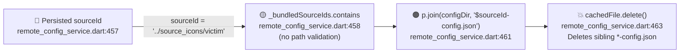

# Kuron Security results

> [!WARNING]
> **Scan Verdict (`kuron-panel` · 2026-11-21T11:58Z)** — **4 findings kept of 4 candidates** (`1 MEDIUM`, `3 LOW`) across 2 scoped files at commit `2e726ac`. All 4 candidates survived **3/3 adversarial lens votes** (`12/12` panel votes); the panel downgraded two severities (`C1 HIGH→LOW`, `C2 HIGH→MEDIUM`).

Low-effort codebase scan of `/tmp/kuron-parent` (worktree at `2e726ac`, pre-fix tree) scoped to `lib/core/config/remote_config_service.dart` + `lib/core/services/source_installer_service.dart` (2 tracked files), run 2026-11-21T11:58Z. Headline: 4 findings kept of 4 candidates — F1 LOW, F2 MEDIUM, F3 LOW, F4 LOW. Every kept finding survived 3/3 lens votes; the panel lowered two severities (C1 HIGH→LOW, C2 HIGH→MEDIUM).

| ID | Severity (Δ Panel) | Confidence | Location (`file:line`) | CWE | 3-Lens Panel (`R` · `I` · `D`) | Title |
|---|---|---|---|---|---|---|
| **F1** | 🔵 **LOW** *(⬇️ from HIGH)* | `high` | `lib/core/config/remote_config_service.dart:407` | `CWE-22` | ✅ `TP` · ✅ `TP (LOW)` · ✅ `TP` (`3/3`) | Path traversal file write via unsanitized remote `sourceId` into configs directory |
| **F2** | 🟡 **MEDIUM** *(⬇️ from HIGH)* | `high` | `lib/core/config/remote_config_service.dart:461` | `CWE-22` | ✅ `TP` · ✅ `TP (MED)` · ✅ `TP` (`3/3`) | Path traversal arbitrary file delete via unsanitized `sourceId` on uninstall |
| **F3** | 🔵 **LOW** *(⬇️ from HIGH)* | `high` | `lib/core/services/source_installer_service.dart:1008` | `CWE-22` | ✅ `TP` · ✅ `TP (LOW)` · ✅ `TP` (`3/3`) | Path traversal file write via unsanitized `sourceId` in icon cache persistence |
| **F4** | 🔵 **LOW** *(⬇️ from HIGH)* | `high` | `lib/core/services/source_installer_service.dart:456` | `CWE-400` | ✅ `TP` · ✅ `TP (LOW)` · ✅ `TP` (`3/3`) | Unbounded ZIP decode of untrusted archive enables resource-exhaustion DoS |

## Coverage

Single-researcher shape (small scope, 2 files), panel-verified. Researcher dispatched 1, returned 1, lost 0; both files read to a conclusion, nothing not-reached. Deliberately not examined: everything outside the two files. This scan targeted the pre-fix tree to exercise the full pipeline including the patch job; findings describe code as of `2e726ac`. No tests ran, no exploit fired.

## Findings

### F1 — Path traversal file write via unsanitized remote sourceId into configs directory (LOW, confidence high)

**Impact.** Attacker-controlled JSON persisted outside `configs/`: overwrite sibling configs/caches, plant source configs the app later trusts.

**Where.** `lib/core/config/remote_config_service.dart:407` in `RemoteConfigService.applySourceConfigFromJson` — CWE-22

**What.** `sourceId` from the remote manifest (non-empty/trim checks only) flows via `candidate.sourceId` into `p.join(configDir.path, '$sourceId-config.json')` with no allowlist or containment; `p.join` does not stop `..`.

**Exploit scenario.** Manifest entry `{id: '../../tmp_evil', url: 'cfg.json'}`; victim opens link; fetched config `source` matches; write lands at `configs/../../tmp_evil-config.json`, restored every startup.

**Preconditions.** Victim opens attacker manifest link/ZIP; entry id and config `source` both carry the traversal; writable AppDocDir.

**Fix.** Allowlist `sourceId` charset, reject separators/`..`/absolute/empty, canonicalize and contain under `configDir` before write.

**Verification.** 3/3 lens verifiers confirmed (severity lowered HIGH→LOW by the panel).

### F2 — Path traversal arbitrary file delete via unsanitized sourceId on uninstall (MEDIUM, confidence high)

**Impact.** Deletion of arbitrary `*-config.json` files under/above `configs/`: persistent loss of configured sources.

**Where.** `lib/core/config/remote_config_service.dart:461` in `RemoteConfigService.uninstallSourceConfig` — CWE-22

**What.** Raw persisted `sourceId` reaches `File(...).delete()` guarded only by exact bundled-id match.

**Exploit scenario.** Victim installs source id `../source_icons/victim`, later uninstalls it; the targeted cached file is deleted.

**Preconditions.** Traversal id persisted via install flow; uninstall invoked with that id.

**Fix.** Same allowlist + containment gate before delete.

**Verification.** 3/3 lens verifiers confirmed (severity lowered HIGH→MEDIUM by the panel).

### F3 — Path traversal file write via unsanitized sourceId in icon cache persistence (LOW, confidence high)

**Impact.** Attacker icon bytes written outside `source_icons/` (extension constrained to image types): cache pollution, planted files.

**Where.** `lib/core/services/source_installer_service.dart:1008` in `SourceInstallerService._persistSourceIconBytes` — CWE-22

**What.** Raw `entry.id` interpolated into icon path; only the extension is allowlisted, the stem is raw.

**Exploit scenario.** Entry `{id: '../configs/pwned', iconUrl}` + ZIP icon bytes; selection writes `source_icons/../configs/pwned.png`.

**Preconditions.** Victim installs/selects attacker entry with traversal id; attacker supplies icon bytes.

**Fix.** Allowlist `sourceId` (or map to sha256/basename); contain resolved path in `iconDir`.

**Verification.** 3/3 lens verifiers confirmed (one vote arrived labeled `confirmed` with confirming reasoning, counted and recorded verbatim; severity lowered HIGH→LOW by the panel).

### F4 — Unbounded ZIP decode of untrusted archive enables resource-exhaustion DoS (LOW, confidence high)

**Impact.** App freeze/OOM crash on malicious ZIP; availability only.

**Where.** `lib/core/services/source_installer_service.dart:456` in `SourceInstallerService.inspectZip` — CWE-400

**What.** `ZipDecoder().decodeBytes` on fully attacker-controlled bytes (also at :636) with no size/count/ratio caps; the existing zip guard is wired only into backup parsers.

**Exploit scenario.** Few-KB zip inflating to GBs; victim opens via import; full in-memory inflation OOM-kills the app.

**Preconditions.** Victim opens attacker ZIP; no pre-decode guard.

**Fix.** Cap archive bytes, entry count, total uncompressed size, compression ratio; abort on breach.

**Verification.** 3/3 lens verifiers confirmed (severity lowered HIGH→LOW by the panel).

## What was verified

One researcher, 4 candidates, 12 lens votes, 4 kept — each with 3/3 affirmative votes and panel-lowered severity where the impact lens rated lower. Status `kuron-panel`: the adapter pipeline completed as designed. This status is not the official Claude Security `verified` stamp, which only the Workflow pipeline can confer.
