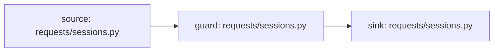

> **Provenance (public, already-patched CVE):** `psf/requests` at historical pre-fix commit [`302225334678490ec66b3614a9dddb8a02c5f4fe`](https://github.com/psf/requests/tree/302225334678490ec66b3614a9dddb8a02c5f4fe) · **CVE-2023-32681** / GHSA-j8r2-6x86-q33q (published 2023-05-22, fixed upstream in 2.31.0 by [74ea7cf7](https://github.com/psf/requests/commit/74ea7cf7a6a27a4eeb2ae24e162bcc942a6706d5)). Rendered by `scripts/kuron_products.py`; the report below is the unmodified generated artifact. No 0-day, no private code, no redactions.

# Kuron Security Scan Results

- **Verification Label:** `ad-hoc-panel`
- **Tier:** `personal`
- **Revision:** `302225334678`
- **Kept Findings:** 1
- **Discarded (pre-panel):** 0

## Kept Findings

### F1 — Proxy credentials leak to HTTPS destination on redirect via Proxy-Authorization header

> [!WARNING]
> **MEDIUM · CWE-200 · F1** — On a redirect to an https:// endpoint, rebuild\_proxies\(\) computes the target scheme at :316 but its guard at :327 checks only username/password, so it reattaches Proxy-Authorization to the prepared re

| Severity | CWE | Sink (`file:line`) | Panel Verdict | Patch Status |
|---|---|---|---|---|
| `MEDIUM` | `CWE-200` | `requests/sessions.py:328` | `3/3 TRUE_POSITIVE` (`ad-hoc-panel`) | `patches/F1.patch` (ready) |

**Flow:** `source` (`requests/sessions.py:317`) -> `guard` (`requests/sessions.py:327`) -> `sink` (`requests/sessions.py:328`)

| Lens | Verdict |
|---|---|
| `R` (Reachability) | `TP` |
| `I` (Impact) | `TP` |
| `D` (Defenses) | `TP` |

Proof trace &amp; guard analysis

**poc_trace**

- `requests/utils.py:1025` — unquote\(parsed.username\) and unquote\(parsed.password\) extract credentials from the proxy URL
- `requests/sessions.py:317` — resolve\_proxies\(\) selects the credentialed proxy URL for the request scheme
- `requests/sessions.py:245` — redirect handling calls rebuild\_proxies\(\) with the new https:// prepared request
- `requests/sessions.py:327` — guard checks only username and password; the scheme variable from :316 is not consulted
- `requests/sessions.py:328` — Proxy-Authorization is written into prepared\_request.headers
- `requests/adapters.py:486` — conn.urlopen\(headers=request.headers\) forwards the header through the HTTPS CONNECT tunnel to the destination

**why_guard_fails**

> The guard at requests/sessions.py:327 tests only that username and password are present. Although :316 computes scheme from the prepared request URL, no scheme.startswith\('https'\) condition is applied, so the header is reattached for HTTPS targets where urllib3 cannot strip it before the CONNECT tunnel. Upstream added that scheme check in commit 74ea7cf7a6a27a4eeb2ae24e162bcc942a6706d5.

## Discarded Findings

None.

## Coverage Ledger

- `skippedComponents`: \[\]
- `over-cap`: \[\]
- `collapsed-shape`: \[\]
- `lostResearchers`: \[\]
